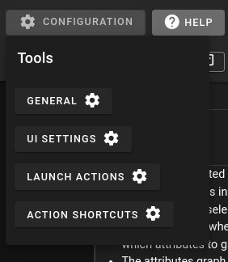
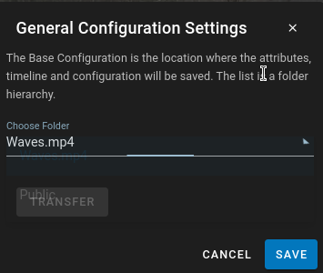
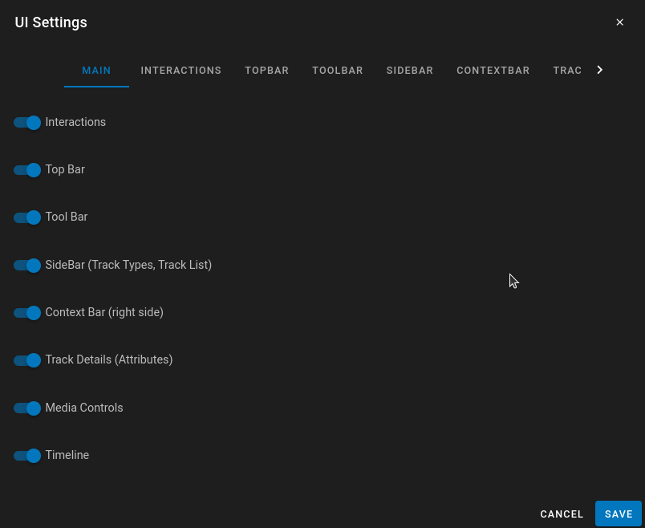
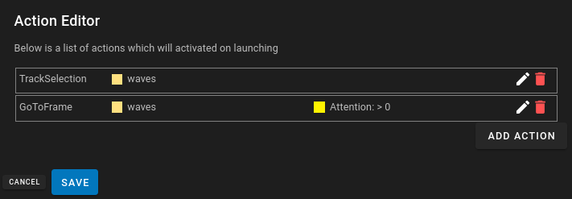
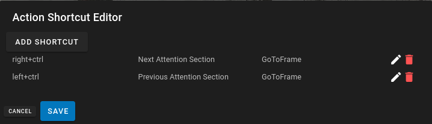

# Configuration




DIVE-DSA has the capability to specify configurations for datasets.  Configurations can customize the user interface and limit the capability of standard users to access features within DIVE.  Things like preventing Editing, Hiding uneeded features can be configured. 

 Additionally launch actions can be configured to select specific tracks or go to specific timeframes based on conditions specified.

 Along with launch actions, special keyboard shortcuts can be configured to perform actions, like selecting tracks or going to specific frames in tracks.

Visual masks are also stored in the dataset configuration.  They are owner/admin-managed rectangular overlays that persist until changed on a later frame.  For usage details, see [Visual Masks](UI-Visual-Masks.md).

## General



The general setting is where you configure the location of the configuration JSON data.  The Configuration can be at any level in the folder hierarchy.  If it is higher in the level all sub folders will use the same configuration.  This is a way that the configuration can be unified amongst all dataset in a folder.

In the dropdown you can choose the folder where the configuration lives.  If you are changing it to a sub folder or a parent folder you can use the 'Transfer' button to move the configuration to the higher level.

### UI Configuration Import / Export

General also provides **Export** and **Import** for a portable **UI Configuration** bundle. This is separate from Download → Configuration on a dataset (see [Web Version](Web-Version.md#download-or-export-data)).

The UI Configuration JSON includes:

* Nested `configuration` (UI Settings, launch actions, action shortcuts, timeline layouts, custom UI, visual masks, general settings)
* Attribute definitions
* Timeline and swimlane graph definitions
* Filters
* Type/group styling and confidence filters

**Export** walks up the folder hierarchy from the open dataset, finds the base configuration folder (where `baseConfiguration` points to itself), and downloads that folder’s full UI Configuration as a `.ui-config.json` file. Server-specific folder ids such as `baseConfiguration` are cleared so the file can move between servers.

**Import** writes to the folder currently selected in the General **Choose Folder** dropdown (the general hierarchy level), not automatically to the open dataset unless that is the selected folder. You need write access on that folder. On import, `baseConfiguration` is rewritten to the destination folder id, the destination’s UI configuration fields are replaced, and any descendant folders that self-reference as their own base have that self-reference cleared so the imported parent configuration takes effect. Confirm the overwrite prompt before continuing; the viewer reloads after a successful import.

See [Data Formats — UI Configuration JSON](DataFormats.md#ui-configuration-json) for the file shape.

## Launch Configs

Under the **Configuration** cog, **Launch Configs** lets the owner of the base configuration add extra launch buttons that open the viewer with the UI configuration of *another* folder. Each entry has a label, optional tooltip and color, and the id of a folder that already has a UI configuration.

* Stored on the write-base configuration only (`configuration.launchConfigs`); it is not merged up or down the hierarchy and is included in UI configuration import/export (folder ids are not remapped).
* The Data Browser and Annotation Data Browser resolve the list once per browsed location (from the write-base configuration). Up to three buttons are shown inline, the rest go in an overflow menu. With no entries the single **Launch Annotator** button is shown.
* Launching adds `?configFolderId=<folderId>` to the viewer URL. This can also be typed or shared directly, e.g. `/viewer/<datasetId>?configFolderId=<folderId>`. The override applies to that session only (it survives refresh, track/frame changes and Prev/Next); the dataset's stored base configuration is not changed. Config edits made while overridden are saved to the override folder.
* If the folder is missing, has no configuration, or is not accessible, a message is shown and the default configuration is used.

### DIVEMetadata Launch Configs

The DIVE Metadata browser (**View Metadata** on a metadata folder) has its own launch config list, separate from the Data Browser / Annotation Data Browser list described above. It is the exception to the write-base rule:

* **Where they are edited:** Folder owners and site admins see a **Launch Configs** (cog) button next to **Edit Filters** in the metadata toolbar. Other users can use the resulting launch buttons but cannot edit the list.
* **Where they are stored:** On **that metadata folder only**, at `folder.meta.configuration.launchConfigs` — merged into the folder's existing `configuration` so other configuration fields are preserved. They are *not* read from the hierarchy write-base configuration, are *not* inherited from a parent folder, and do *not* carry over to a different (e.g. child or sibling) metadata folder. Each metadata folder that needs custom launch buttons needs its own list. Conversely, a list configured here does not appear in the Data Browser, and a Data Browser list does not appear here.
* **Scope:** The same list is used for **every dataset row** in that metadata view. It is resolved once per metadata folder, not per dataset. If the list is empty, each row shows the default **Launch Annotator** button instead.
* **Launching:** Clicking a button opens `/viewer/<datasetId>?configFolderId=<folderId>&diveMetadataRootId=<metadataFolderId>`. The `diveMetadataRootId` is included on every launch (including the default button) so the viewer stays linked to the metadata collection. The open-in-new icon (`| mdi-open-in-new`) next to a button opens the same link in a new tab. Otherwise the `configFolderId` session override behaves as described above.

#### Options

Each entry in the editor is one launch button:

| Field | Required | Description |
|---|---|---|
| `label` | Yes | Text shown on the launch button. Saving is blocked while any label is empty. |
| `configurationFolderId` (**Config folder id**) | Yes | Girder folder id whose stored UI configuration (`meta.configuration`) is applied for the launched session. On save the folder is validated: it must exist, be accessible to you, and already have a configuration. Its name is shown under the field when valid; otherwise an error (`Folder has no configuration` / `Folder not found or no access`) blocks saving. |
| `color` (**Color**) | No | Button color, picked from the color swatch or entered as a hex value (e.g. `#1976D2`). New entries default to `#1976D2`; non-hex legacy theme names are normalized to that default when the editor is opened. |
| `tooltip` (**Tooltip**) | No | Optional hover text for the button (shown as the title on overflow-menu entries). |

Entries are displayed in editor row order (stored as `order`, sorted ascending). Up to three buttons are shown inline on each row; additional entries go into the **⋯** overflow menu. Use **Add** to append an entry and the trash icon to remove one; removing all entries and saving restores the default **Launch Annotator** button.

The stored value on the metadata folder looks like:

```json
{
  "configuration": {
    "launchConfigs": [
      {
        "id": "17290000000000",
        "label": "Review",
        "tooltip": "Open with the review configuration",
        "color": "#1976D2",
        "configurationFolderId": "<girder-folder-id>",
        "order": 0
      }
    ]
  }
}
```

(`id` is generated by the editor and is not user-editable. Folder ids are Girder ids specific to this server, so entries generally need to be re-validated/re-created if the metadata folder is moved to another server.)

#### Troubleshooting

* **Buttons missing in the metadata view:** you are likely viewing a different metadata folder than the one the list was saved on, or the saved list is empty. Launch configs do not resolve through the parent hierarchy or down into child folders.
* **Launch Configs button missing:** only folder owners (write access) and site admins can edit the list.
* **Viewer opens with the default configuration:** the target folder was deleted, lost its configuration, or is not accessible to the launching user — a `Config folder unavailable` message is shown and the dataset's default configuration is used.

## UI Settings



UI settings enable toggling of differnt UI elements in the UI for all users.
For more details I would go specifically to the [UI-Settings](UI-Settings.md )section to view the elements


## Launch Actions




Launch Actions are actions that are created on launch which automatically trigger certain behaviors.
There are two types of launch actions currently.
For more details I would go specifically to the [UI-Actions](UI-Actions.md )section to view the details.


## Action Shortcuts



Action shortcuts are similar to launch actions except they are triggered by a customizable keyboard shortcut instead of being triggered on launch.  Any Action configured in Launch Actions can be configured to a shortcut.  This also includes the capability to select next/previous for tracks and timeframes that match conditions.
For more details I would go specifically to the [UI-Actions](UI-Actions.md)section to view the details.


## UI Configuration JSON

The User interface configuration is stored in the metadata of the Dataset Folder, or the parent folder which contains the item.

Go to [UI-ConfigurationJSON](UI-ConfigurationJSON.md) for more information
